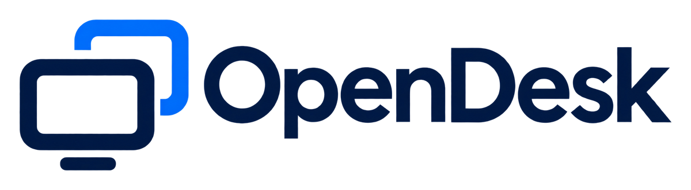
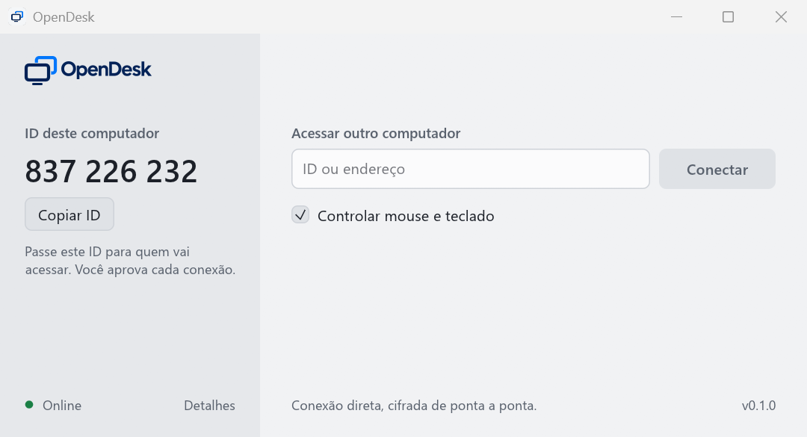

<h1>
  <picture>
    <source media="(prefers-color-scheme: dark)" srcset="assets/brand/logo-dark.png">
    
  </picture>
</h1>

Acesso remoto ponto a ponto, gratuito e de código aberto. Uma alternativa ao AnyDesk sem conta, sem anúncios, sem limite de tempo e sem servidor no meio da sua conexão.

> **Estado: MVP.** Funciona entre computadores Windows: por ID pela internet, ou por endereço na mesma rede. A conexão entre duas redes diferentes ainda não foi testada em campo. Veja [o que falta](docs/ARCHITECTURE.md#roteiro).

<picture>
  <source media="(prefers-color-scheme: dark)" srcset="docs/images/app-dark.png">
  
</picture>

## O que já funciona

- Compartilhar a tela e controlar mouse e teclado de outro computador Windows.
- **Conexão por ID**: um servidor de encontro apresenta os dois computadores e eles conectam direto um ao outro, perfurando o NAT. O servidor nunca vê a sessão.
- **Relay opcional**: se a rede não deixar conectar direto, a sessão passa por um relay que você mesmo hospeda. Ele só repassa pacotes cifrados e não consegue ler nada.
- **Transparência**: a barra da sessão mostra a rota (direta por endereço, rede local, ponto a ponto ou via relay), a latência, os quadros por segundo e o bitrate; codec e resolução aparecem ao passar o ponteiro.
- **Autorização explícita**: toda conexão precisa ser aprovada por quem está no computador, que escolhe entre só ver ou permitir controle. A sessão ativa fica sempre visível e pode ser encerrada com um clique.
- **Cifragem de ponta a ponta**: QUIC com TLS 1.3 e identidade criptográfica por dispositivo. Não há servidor que possa ler a sessão.
- Imagem sem perdas para texto e interface, JPEG para foto e vídeo, com refinamento automático quando a tela para.
- Um executável único, sem instalador.

## Usar

No computador que será acessado, abra o OpenDesk e informe a quem vai acessar o **ID** (ou o endereço) que aparece em "ID deste computador". No outro computador, digite-o em "Acessar outro computador" e clique em **Conectar**. O primeiro computador mostra o pedido; aprove. A janela maximiza-se durante a sessão e volta ao tamanho normal quando ela termina.

O app segue o tema claro ou escuro do Windows; `OPENDESK_THEME=light` ou `dark` fixa um deles.

O ID vem do servidor de encontro do projeto. Para usar o seu, defina a variável de ambiente `OPENDESK_RENDEZVOUS` com o endereço dele (por exemplo `wss://seu-servidor.workers.dev`) antes de abrir o OpenDesk; `OPENDESK_RENDEZVOUS=off` desliga o servidor e deixa só a conexão por endereço.

Na primeira execução o Firewall do Windows pergunta se o OpenDesk pode receber conexões. Permita em redes privadas.

## Compilar

Requer [Rust](https://rustup.rs) 1.88 ou mais novo e as Ferramentas de Build do Visual Studio.

```bash
cargo build --release
```

Os executáveis ficam em `target/release/`: `opendesk.exe` (aplicativo), `opendesk-cli.exe` (linha de comando) e `opendesk-relay.exe` (relay).

```bash
cargo test
```

Testes que tocam a tela e o mouse reais ficam ignorados por padrão:

```bash
cargo test -p opendesk-platform -- --ignored
```

### Testar numa máquina só

A CLI permite exercitar o caminho inteiro em loopback. Num terminal:

```bash
target/release/opendesk-cli host --port 47811 --auto-accept-loopback view
```

Em outro:

```bash
target/release/opendesk-cli view 127.0.0.1:47811 --seconds 5 --out tela.png
```

`--auto-accept-loopback` existe só para testes e restringe a escuta a `127.0.0.1`.

## Servidor de encontro

Fica em [`rendezvous/`](rendezvous/): um Cloudflare Worker com um Durable Object por ID, que cabe no plano gratuito. Para rodar localmente:

```bash
cd rendezvous && npm install && npm run dev
```

Isso sobe o servidor em `ws://127.0.0.1:8787`. Para publicar na sua conta Cloudflare:

```bash
cd rendezvous && npx wrangler deploy
```

O servidor só troca endereços entre os pares. Ele exige que cada dispositivo prove a posse da chave do ID que registra, e não consegue ler nem alterar uma sessão.

## Relay

Algumas redes não deixam dois computadores se conectarem direto. Para esses casos, rode um relay numa máquina com IP público e a porta UDP 47800 aberta:

```bash
opendesk-relay --port 47800
```

E aponte **um** dos dois computadores para ele com a variável de ambiente `OPENDESK_RELAY` (por exemplo `relay.exemplo.com:47800`). O OpenDesk tenta a conexão direta primeiro e só usa o relay se ela falhar; a barra da sessão mostra "Via relay". O relay tem limites de sessões e de banda (`opendesk-relay --help`) e não tem como ler a sessão, que continua cifrada de ponta a ponta.

## Como é feito

Rust de ponta a ponta, em crates pequenos: protocolo, codec, rede, plataforma, sessão e interface. A explicação completa, as decisões e o que foi aprendido observando o AnyDesk estão em [docs/ARCHITECTURE.md](docs/ARCHITECTURE.md).

## Compromissos

- Nenhum limite artificial de duração ou de uso.
- Nenhuma detecção de "uso comercial".
- Nenhuma telemetria.
- Nenhum acesso sem autorização de quem está no computador ou sem credencial válida definida por ele.

## Licença

[Apache-2.0](LICENSE).
